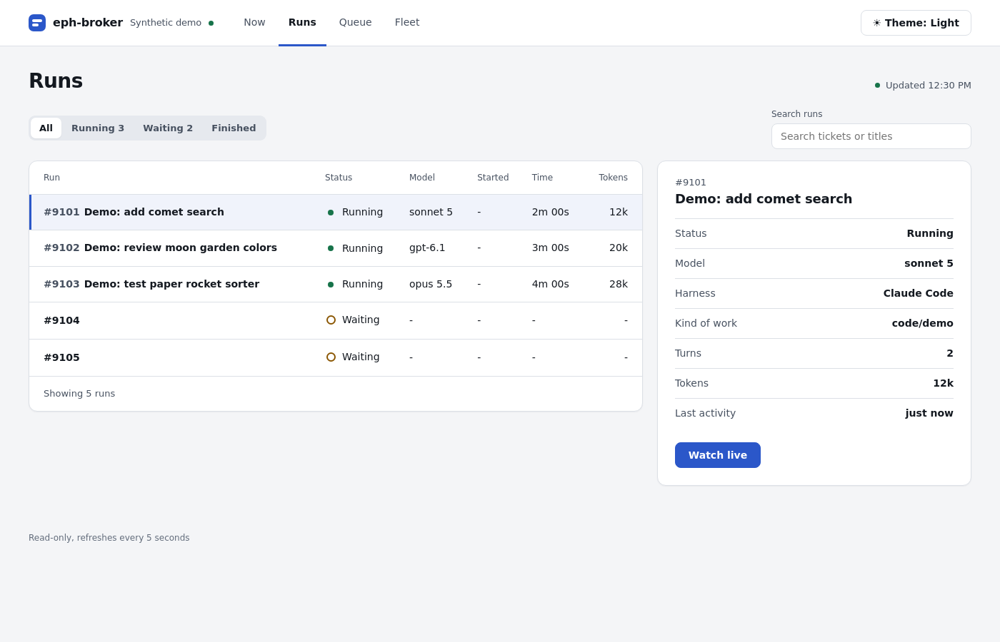

<p align="center"></p>

<h1 align="center">eph-broker</h1>

<p align="center">
  <b>Turn a ticket into a merge request you can review.</b><br>
  A short-lived coding agent makes a commit, the broker opens the merge request, and a second agent reviews it. You decide whether to merge.
</p>

<p align="center">
  <a href="#quick-start">Quick start</a> ·
  <a href="#features">Features</a> ·
  <a href="docs/install.md">Install guide</a> ·
  <a href="#configuration">Configuration</a> ·
  <a href="#docs">Docs</a>
</p>

<p align="center">
  <a href="LICENSE"></a>
  
  
</p>

```text
 ticket or GitLab issue                         you
          |                                      ^
          v   webhook                            | merge, or ask for changes
  +----------------+  batch, route   +----------------------+
  |   eph-broker   | --------------> |  worker (throwaway   |
  | (one process,  |                 |  git worktree, one   |
  |  stdlib only)  | <-------------- |  agent CLI session)  |
  +----------------+   local commit  +----------------------+
          |
          | pushes a fresh branch, opens the MR
          v
     GitLab merge request  --->  second agent reviews it
```

It is for people who already file work as tickets and want an agent to take a first pass at the small ones. It runs on one Linux host, uses only the Python standard library, and keeps you in charge of every merge. Workers never push; only the broker does, and only to a fresh branch.

**Real code changes need a paid or otherwise funded agent account.** The default agent is [Claude Code](https://www.anthropic.com/claude-code), installed and logged in as the broker's OS user. [hermes-agent](docs/hermes.md) is also supported. The preview below needs no account, repo or token.

## Quick start

You need Linux, git, and either Python 3.9+ or [Docker Engine](https://docs.docker.com/engine/install/) with the [Compose plugin](https://docs.docker.com/compose/install/linux/). Allow about 10 minutes.

```sh
git clone https://github.com/mdbook/eph-broker
cd eph-broker
docker compose up --build -d
```

Open [the dashboard](http://127.0.0.1:8787/dash.html). [Health](http://127.0.0.1:8787/health) should show `"ok": true` and no live workers. If `docker compose ps` is not healthy, check `docker compose logs broker`. Port 8787 must be free. Stop with `docker compose down`; add `-v` to delete the preview state.

No Docker? From the same checkout, no packages needed:

```sh
BROKER_SITE_ENV=/dev/null BROKER_CONFIG=config/demo/broker.example.json python3 app.py
```

Use the same links, Ctrl-C to stop. State goes in `demo-state/`. Run it from a clean shell without broker tokens, because real environment variables override the example.

**This previews the service, not a first merge request.** It uses the shipped [demo config](config/demo/broker.example.json) with no secrets, no repo access and no agent CLI. Webhooks are refused while their tokens are unset, and nothing is sent to an AI provider. There is no published image yet, so Compose builds locally. More in the [Docker guide](docs/docker.md).

### Going further: real code changes

The shortest supported path uses GitLab issues. It needs more than a service start:

- Claude Code logged in for a dedicated broker user, on an account that can pay for workers.
- A GitLab project and a bot with Developer access and an `api` token.
- A local checkout of that project with an HTTPS origin, a push credential and a git identity.
- Your allowed issue authors, bot account names and approved worker prompts.
- A reverse proxy and a GitLab issue webhook.

The [first merge request checklist](docs/first-merge-request.md) walks through every step and check. Allow 30 to 60 minutes once the accounts are ready, plus agent run time. I don't promise a ten-minute first MR. Vikunja users also need the bridge and an n8n workflow, covered in the same guide.

## Configuration

Settings are environment variables plus a few JSON files in `config/`. Start from the examples (`config/site.example.env`, `config/provenance.example.json`) and keep secrets out of `site.env` and git.

Set top-level `model_denylist: ["restricted-family"]` in `broker.yaml` (see
[`config/broker.example.yaml`](config/broker.example.yaml)) to forbid model ids containing any listed
case-insensitive literal substring. The default is `[]`. Restart after changing it. Every worker harness
checks the final resolved model immediately before launch, after route pins, mode/backend selection and
environment remapping. A match refuses the launch and comments the ticket with the reason, without
silently falling back to another model. External TFA launchers receive the comma-joined list in
`BROKER_MODEL_DENYLIST` (empty when unrestricted). They must enforce the same case-insensitive literal
substring policy on their final resolved model and refuse matching launches without silently falling
back to another model. Invalid lists stop broker startup.

| What | Where |
|---|---|
| Every environment variable and its default | [docs/settings.md](docs/settings.md) |
| The files you touch, secrets, limits, models | [docs/configuration.md](docs/configuration.md) |
| Your own worker types | [docs/routes.md](docs/routes.md) |
| Which prompts workers may run | [docs/prompts.md](docs/prompts.md) |

## Features

- **Ticket to MR.** A webhook starts a worker in its own git worktree. It commits locally, and the broker pushes a fresh branch and opens the merge request.
- **Built-in review.** A second agent session reviews each MR. Merging stays manual unless you turn on the optional [auto-merge path](docs/cd-deploy-paths.md).
- **Burst batching.** Saving a ticket fires several webhooks. The broker waits a few seconds so they become one worker with one brief, and follow-up comments reach the same worker.
- **Pluggable agents.** Claude Code by default, [hermes-agent](docs/hermes.md) and other CLIs through [adapters](docs/adapters.md), with [custom worker types](docs/routes.md).
- **Your tracker.** GitLab issues and [GitHub opened issues](docs/github-issues.md) work natively (signed intake and summary comments; no GitHub PR support yet). [Vikunja](https://vikunja.io) and others plug in through a [small script](docs/tracker-script.md) and [n8n](https://n8n.io) workflows ([ready-made](docs/n8n.md)).
- **Dashboard and events.** Tabbed worker and queue views, a separate Settings page and phone hamburger navigation
  ([dashboard guide](docs/operations.md#health-and-the-dashboard)), plus [signed run events](docs/events.md) for your own automation.
- **Optional UI modules.** [Add a tab](docs/modules.md#try-it-in-ten-minutes) without embedding another app in the broker.



See [Refreshing screenshots](CONTRIBUTING.md#refreshing-screenshots) for the repeatable capture command, including the Now overview.

## Security

Run it isolated, with only the repos and credentials it needs, not your everyday login. **A container around the broker does not isolate workers from broker credentials**: workers run as the broker's OS user, and tool permissions are not a sandbox. The dashboard has no built-in login, so keep it on loopback and use an authenticating reverse proxy for remote access. Read the [security model](docs/security.md) before enabling webhooks.

## Limits

- Merge requests are GitLab only. Native issue webhooks support GitLab and [GitHub opened issues](docs/github-issues.md); there is no GitHub PR support yet.
- One host runs the broker. Durable maintenance queues use local SQLite; other state is memory and JSON files.

## Docs

The full index is [docs/README.md](docs/README.md). Highlights:

- [Concepts](docs/concepts.md): follow one ticket from webhook to merge request.
- [Install guide](docs/install.md): from source, RPM and systemd, and wiring webhooks.
- [Operations](docs/operations.md): logs, `/health`, reloads, re-running a ticket, upgrading.
- [Agent CLIs](docs/adapters.md) and [prompt architecture](docs/prompts.md).
- [Maintenance drain](docs/drain.md), [live routing overrides](docs/routing-overrides.md), [test runners and worktrees](docs/worker-runtime.md).
- [GitHub Issues intake](docs/github-issues.md) and [other trackers](docs/tracker-script.md).
- [FAQ and costs](docs/faq.md).

## Contributing

See [CONTRIBUTING.md](CONTRIBUTING.md). Short version: `sh tools/check.sh` runs the full test gate without real agents.

## License

GPL-3.0-or-later. See [LICENSE](LICENSE).
