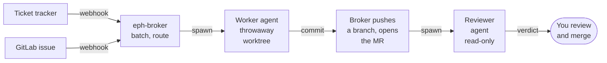
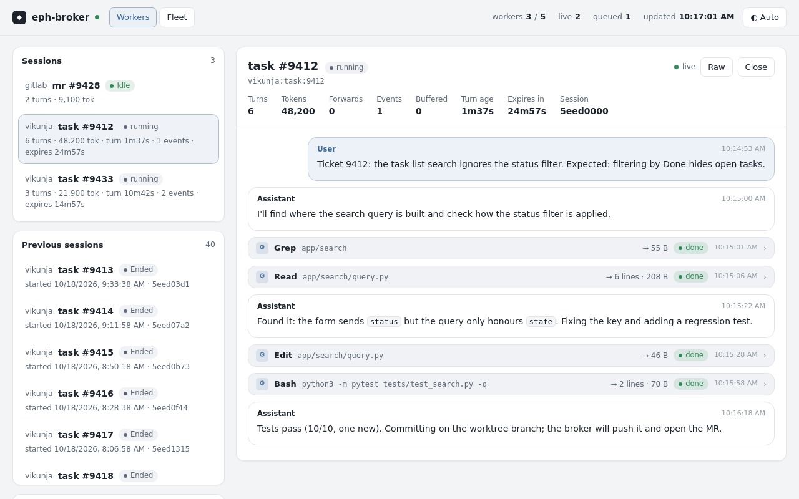
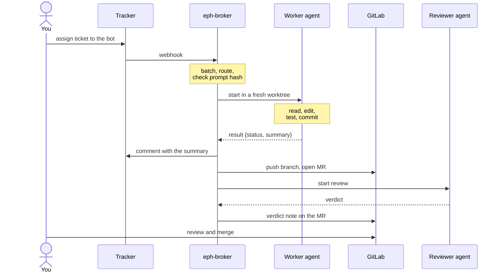
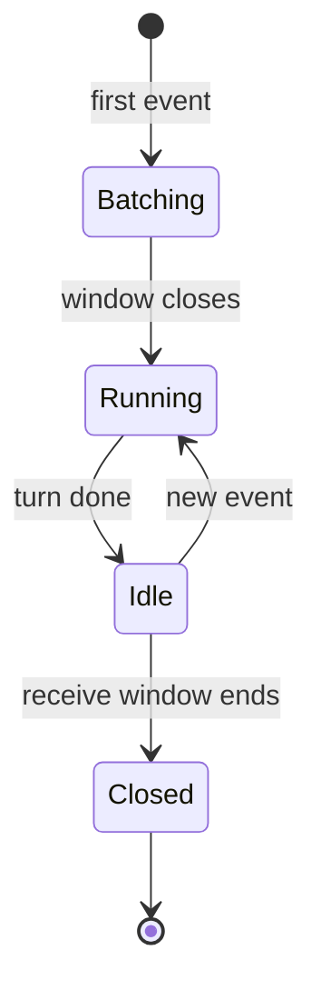

# eph-broker

eph-broker is a standard-library Python service that takes a ticket you assign to a bot, has a short-lived coding agent
make the change in a throwaway git worktree, and hands you back a GitLab merge request that a second, read-only
agent has already reviewed. The agent runs on a harness, an agent CLI the broker drives: Claude Code by default,
hermes-agent as an option, and others can be added ([docs/adapters.md](docs/adapters.md)).

You can add your own kinds of worker without touching code. A row is one entry in the broker's routing table:
a trigger plus the worker it starts. One row in `config/routes.json` says which label or assignee starts it, which signed prompt it runs and which built-in tool grant it gets. Prompts are put
together from small Markdown modules, so a new worker is usually a short manifest and a module or two, not a
whole prompt written from scratch.

## What you need

- A ticket source that can send webhooks. GitLab issues in, merge request out, with no extra glue; the
  worker's summary comes back as a comment on the issue. A tracker needs a small tap that reshapes its webhooks into the broker's event
  format, plus a script you write that reads tickets and posts comments (contract in
  [docs/tracker-script.md](docs/tracker-script.md)). Both are shaped for [Vikunja](https://vikunja.io) today.
- GitLab, a bot token that can open merge requests, and a push credential for each repo the bot may touch.
- A harness CLI on the broker host. Every built-in row uses the
  [Claude Code](https://docs.anthropic.com/en/docs/claude-code) CLI by default (tested with Claude Code 2.1),
  logged in as the user the broker runs as. Workers use that stored login: API keys and tokens in the
  environment (`ANTHROPIC_API_KEY`, `CLAUDE_CODE_OAUTH_TOKEN`) are deliberately not passed to them.
  [hermes-agent](https://github.com/NousResearch/hermes-agent) is an optional second harness.
- A Linux host with Python 3.9+ and git (tmux only for the interactive-agent row). There are no Python dependencies.
- Your own settings in `config/site.env` (hosts, repos, links) and signed worker prompts. You render each
  prompt, read it and record its hash before any worker will start. Turn and time limits live in
  `config/constraints.json`, and its defaults are fine to begin with.





## A first merge request

The shortest path uses a GitLab issue as the ticket, so you don't need tracker glue yet. Clone the target repo
on the broker host with an https `origin`, then set up the broker.

```sh
git clone https://github.com/mdbook/eph-broker && cd eph-broker
cp config/provenance.example.json config/provenance.json
cp config/site.example.env config/site.env
```

`provenance.json` lists your bot and service accounts, so the broker ignores the edits they make. For this
quick start, put your GitLab bot user in it ([docs/configuration.md](docs/configuration.md#who-counts-as-an-agent)).

These go in `config/site.env`, with your own values in place of the examples.

```sh
GITLAB_WEB_URL=https://gitlab.example.com
BROKER_PUSH_HOSTS=gitlab.example.com
ISSUE_REPO_MAP=gitlab:group/app=/srv/git/app
# who may start work by opening an issue; nobody can until you list them
ISSUE_AUTHOR_ALLOWLIST=your-gitlab-username
# optional: lets the worker run this repo's tests (pytest, npm, go, ...)
CODE_REPO_RUNNER_SEEDS=/srv/git/app=pytest
```

Two secrets go in the broker's environment rather than `site.env`. `GITLAB_MR_TOKEN` (scope `api`, Developer
on the project) opens MRs and posts notes, and `GITLAB_WEBHOOK_TOKEN` is the value GitLab must send as
`X-Gitlab-Token`. A third, `BROKER_HMAC_SECRET`, only matters once a tracker tap sends `POST /event`: the broker
refuses unsigned events, so it has to be set and the tap has to sign.

Then set up the user the broker runs as:

- a push credential for the repo: one line for exactly that repo's path in `~/.git-credentials`, like
  `https://<user>:<token>@gitlab.example.com/group/app.git`
  ([docs/repo-push-cred.md](docs/repo-push-cred.md) has the details);
- a git identity for the worker's commits (`git config --global user.name` and `user.email`);
- write access to the checkout's `.git`, because each worker gets a `git worktree` of it.

Read the three shipped prompts in `prompts/` and either accept their hashes in `approved-prompts.json` or sign
your own ([docs/prompts.md](docs/prompts.md)). Start the broker with the secrets in its environment
(`set -a; . /etc/eph-broker/eph-broker.env; set +a; python3 app.py`), put a reverse proxy in front of
`127.0.0.1:8787`, and add a GitLab project webhook for issue events pointing at `/webhooks/gitlab` with the same
secret token. Open an issue. A few seconds later a worker starts; when it finishes you get an `eph/issue/...`
branch, an MR that closes the issue when you merge it, a review note on the MR, and the worker's summary as a
comment on the issue. If no MR shows up, the comment says why; `/runs/<key>`, the dashboard and the broker's
log have the rest ([docs/operations.md](docs/operations.md#finding-the-result-of-a-gitlab-issue)).

[docs/install.md](docs/install.md) covers the RPM, systemd and the tracker path.

## Try it without anything attached

After the two `cp` commands above, this runs the broker and its dashboard with no tracker, GitLab or agent.

```sh
EVENTS_LOG=$PWD/events.jsonl python3 app.py
```

Then run these in another terminal.

```sh
curl -s 127.0.0.1:8787/health          # {"ok": true, ...}
xdg-open http://127.0.0.1:8787/dash.html
sh tools/check.sh                      # the test suite; no network or real agents needed
```

## How it works

A webhook arrives, either `POST /event` from your tracker's tap or `POST /webhooks/gitlab` from GitLab. The broker
drops events its own comments caused, then waits a few seconds so a burst of edits on one ticket turns into
one worker. If that ticket already has a worker running, the event is handed to it instead.

Routing goes by assignee or label to a worker class. Three classes ship with signed prompts.

| Class | Starts when | What it may do | Result |
|---|---|---|---|
| `code/change-proposer` | label `eph:code-change`, assignee `eph-code`, or a new GitLab issue | edit files, commit, run one named test runner; no push | comment and MR |
| `general/agent` | assignee `eph`, or label `eph:general` | most tools, minus a deny list for secrets, pushes and destructive commands | comment, optional MR |
| `mr-review/agent` | the broker just opened an MR | read files only | verdict note on the MR |

Your own classes go in `config/routes.json` ([docs/routes.md](docs/routes.md)). They pick up tickets the
built-in rows don't claim, ahead of the general catch-all.

The worker gets a fresh worktree, a turn cap, a time limit and its signed system prompt. It ends with a small
JSON result (`done` or `blocked`, plus a summary). The broker posts the summary as a comment on the ticket or
GitLab issue. Then it pushes the worker's commit to a new branch, opens the MR and starts the reviewer. Merging stays with you.



A ticket has at most one worker at a time. The worker stays warm for a short window so follow-up comments
reuse it, then exits.



[docs/concepts.md](docs/concepts.md) walks through events, batching, routing and publishing in more detail.

## Prompt architecture

Worker prompts are built from small Markdown modules rather than written as one file per worker. This is
what ships.

- `modules/` holds 12 fragments grouped by job: `role/`, `scopes/`, `capabilities/`, `constraints/` and
  `outputs/`.
- `workers/<domain>/<class>.json` is a manifest per class (three ship). It lists modules in order and fills
  `{{var}}` slots by plain string replacement.
- `tools/render-prompts.py` renders each manifest to `prompts/<domain>/<class>.md`. With `--check` it exits 1
  when a committed prompt no longer matches its manifest, and `tools/check.sh` runs it.
- `modules/site/<section>.md`, if you create it, replaces `modules/<section>.md` at render time. That's where
  your own wording goes, so pulling a new release never overwrites it.
- `approved-prompts.json` maps each `<domain>/<class>` to the sha256 of its rendered prompt. `prompts.py`
  refuses to start a worker whose prompt file doesn't hash to that value.

The hashes in this repo cover the generic prompts as shipped. Read them before you trust them, and re-sign
after any change. [docs/prompts.md](docs/prompts.md) covers inline sources, the render check and adding a
new agent type, which takes a prompt and one row in `config/routes.json`.

## Security model

Workers have no tokens and only commit locally; the broker is the only thing that pushes, comments or opens
MRs. For the shipped classes it pushes only to a fresh branch, and only to a host listed in
`BROKER_PUSH_HOSTS`. Each class gets its own tool allowlist plus a fixed deny list (secret files, `.git`
writes, pushes, destructive shell), enforced by the harness: Claude Code's permission flags, or hermes'
`eph-gate` plugin. Secrets are scrubbed from the worker's environment, and repo instruction files
(`CLAUDE.md`, `AGENTS.md`) are removed from the worktree. On Claude Code the signed prompt replaces the CLI's
default one; hermes adds some text of its own around it. The general worker also loads the service user's
user-level Claude Code settings and `~/.claude/CLAUDE.md`, so keep those deliberate. The broker listens on 127.0.0.1
only, and the GitLab and re-run endpoints refuse every request until their token is set.

The big caveat is that workers run as the broker's OS user. Tool grants are not a sandbox, so a worker with
shell access can read whatever the broker can. [docs/security.md](docs/security.md) explains the model and
[docs/security-residual-same-uid.md](docs/security-residual-same-uid.md) the parts code can't fix.

## Limitations

- Merge requests and issue webhooks are GitLab only.
- Tracker reads, comments and labels go through a script you write (`BROKER_MCP_SH`), shaped for Vikunja
  ([docs/tracker-script.md](docs/tracker-script.md)). GitLab issues only get comments: no labels or
  assignees.
- Three worker classes have prompts. `routing.py` has rows for other kinds of worker; they stay inert until
  you write and sign prompts for them.
- One host. State lives in memory plus a few JSON files next to the event log.
- Merging is manual. Two optional paths, both off by default, can merge for you: the CD module (`cd.py`)
  merges reviewed MRs in repos you allowlist, and `AUTO_MERGE_REPOS` merges a listed repo's MRs on a green
  pipeline with no reviewer.

## Documentation

Everything else is under [docs/](docs/README.md), starting from the index there. To run workers on another
agent CLI, see [docs/adapters.md](docs/adapters.md). To hook it up to n8n (taps in, run events out), see
[docs/n8n.md](docs/n8n.md); self-hosted n8n can also use the nodes in
[integrations/n8n-nodes-eph-broker](integrations/n8n-nodes-eph-broker/README.md).

## License

GPL-3.0-only. See [LICENSE](LICENSE).
