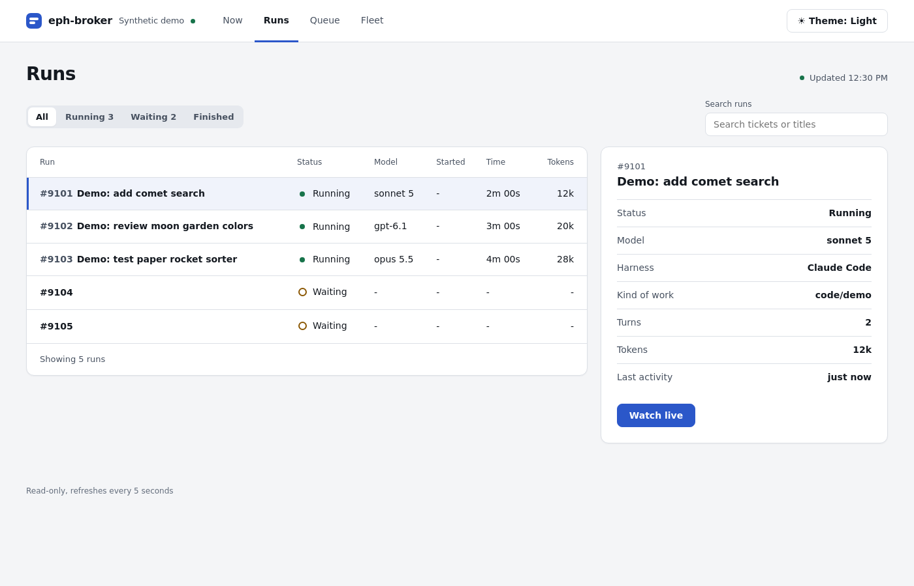

<p align="center"></p>

<h1 align="center">eph-broker</h1>

<p align="center">
  <b>Turn a ticket into a merge request you can review.</b><br>
  A short-lived coding agent makes a commit, the broker opens the merge request, and a second agent reviews it. You decide whether to merge.
</p>

<p align="center">
  <a href="#quick-start">Quick start</a> ·
  <a href="#features">Features</a> ·
  <a href="docs/install.md">Install guide</a> ·
  <a href="#configuration">Configuration</a> ·
  <a href="#docs">Docs</a>
</p>

<p align="center">
  <a href="LICENSE"></a>
  
  
</p>

```text
 ticket or GitLab issue                         you
          |                                      ^
          v   webhook                            | merge, or ask for changes
  +----------------+  batch, route   +----------------------+
  |   eph-broker   | --------------> |  worker (throwaway   |
  | (one process,  |                 |  git worktree, one   |
  |  stdlib only)  | <-------------- |  agent CLI session)  |
  +----------------+   local commit  +----------------------+
          |
          | pushes a fresh branch, opens the MR
          v
     GitLab merge request  --->  second agent reviews it
```

It is for people who already file work as tickets and want an agent to take a first pass at the small ones. It runs on one Linux host, uses only the Python standard library, and keeps you in charge of every merge. Workers never push; only the broker does, and only to a fresh branch.

**Real code changes need a paid or otherwise funded agent account.** The default agent is [Claude Code](https://www.anthropic.com/claude-code), installed and logged in as the broker's OS user. [hermes-agent](docs/hermes.md) is also supported. The preview below needs no account, repo or token.

Workers with a configured `ZBUS_ENV` may DM fleet bots using `AGENT_DM_RECIPIENTS` (default `*-bot@*`), except `AGENT_DM_DENY` (default `*-driver-bot@*`, deny wins). This does not create bus identities or allow channel posts. The Hermes general arm allows a valid DM before the exec judge; other commands still go through the judge. See [settings](docs/settings.md).

## Quick start

You need Linux, git, and either Python 3.9+ or [Docker Engine](https://docs.docker.com/engine/install/) with the [Compose plugin](https://docs.docker.com/compose/install/linux/). Allow about 10 minutes.

```sh
git clone https://github.com/mdbook/eph-broker
cd eph-broker
docker compose up --build -d
```

Open [the dashboard](http://127.0.0.1:8787/dash.html). [Health](http://127.0.0.1:8787/health) should show `"ok": true` and no live workers. If `docker compose ps` is not healthy, check `docker compose logs broker`. Port 8787 must be free. Stop with `docker compose down`; add `-v` to delete the preview state.

No Docker? From the same checkout, no packages needed:

```sh
BROKER_SITE_ENV=/dev/null BROKER_CONFIG=config/demo/broker.example.json python3 app.py
```

Use the same links, Ctrl-C to stop. State goes in `demo-state/`. Run it from a clean shell without broker tokens, because real environment variables override the example.

**This previews the service, not a first merge request.** It uses the shipped [demo config](config/demo/broker.example.json) with no secrets, no repo access and no agent CLI. Webhooks are refused while their tokens are unset, and nothing is sent to an AI provider. There is no published image yet, so Compose builds locally. More in the [Docker guide](docs/docker.md).

### Going further: real code changes

The shortest supported path uses GitLab issues. It needs more than a service start:

- Claude Code logged in for a dedicated broker user, on an account that can pay for workers.
- A GitLab project and a bot with Developer access and an `api` token.
- A local checkout of that project with an HTTPS origin, a push credential and a git identity.
- Your allowed issue authors, bot account names and approved worker prompts.
- A reverse proxy and a GitLab issue webhook.

The [first merge request checklist](docs/first-merge-request.md) walks through every step and check. Allow 30 to 60 minutes once the accounts are ready, plus agent run time. I don't promise a ten-minute first MR. Vikunja users also need the bridge and an n8n workflow, covered in the same guide.

## Configuration

Settings are environment variables plus a few JSON files in `config/`. Start from the examples (`config/site.example.env`, `config/provenance.example.json`) and keep secrets out of `site.env` and git.

**Operator config is separate from code.** The RPM sets `BROKER_CONFIG_DIR=/etc/eph-broker` in the service.
That directory holds `broker.yaml` or `broker.json`, `site.env`, all site JSON files (including constraints
and routes), `prompts/<domain>/<class>.md` and `approved-prompts.json`. The first upgrade from an older RPM
copies the existing `/opt/eph-broker/config`, prompts and approvals there **before** replacing packaged files.
New installs copy shipped defaults once. Initialization merges only missing paths, preserving existing operator
files and their modes/ownership, including an EnvironmentFile already in that directory. The completion marker
`.eph-config-initialized` prevents later upgrades from writing config, even if a file has been removed. Keep this
marker when backing up or restoring config. Review new packaged defaults explicitly rather than restoring
constraints after upgrades.

For source installs, in-repo paths remain the working defaults. To opt into a separate directory, seed it once:

```sh
python3 config_paths.py /path/to/site-config
BROKER_CONFIG_DIR=/path/to/site-config python3 app.py
```

Set the directory in the process environment (a systemd drop-in for RPM installs), not inside its own config.
Existing individual path overrides still win; remove old overrides pointing into `/opt/eph-broker` when migrating.
No fallback to packaged prompts or signatures occurs for an external config directory. Keep it writable only by
trusted operators; grant the broker write access to `routing-overrides.json` and its parent only if dashboard
editing is enabled. To change a prompt, render/review it, copy the rendered file into this directory and update
its approved SHA256 there after operator sign-off. Both are read on every launch, so no RPM or restart is needed
for built-in rows. Routes are validated at startup, so restart after changing prompts used by site-defined routes.
Unsigned or changed prompts still refuse to run. JSON policies reload on SIGHUP; `site.env` and bootstrap paths
require restart. See [installation](docs/install.md) and [prompts](docs/prompts.md).

Set top-level `model_denylist: ["restricted-family"]` in `broker.yaml` (see
[`config/broker.example.yaml`](config/broker.example.yaml)) to forbid model ids containing any listed
case-insensitive literal substring. The default is `[]`. Reload with SIGHUP after changing it. Every worker harness
checks the final resolved model immediately before launch, after route pins, mode/backend selection and
environment remapping. A match refuses the launch and comments the ticket with the reason, without
silently falling back to another model. External TFA launchers receive the comma-joined list in
`BROKER_MODEL_DENYLIST` (empty when unrestricted). They must enforce the same case-insensitive literal
substring policy on their final resolved model and refuse matching launches without silently falling
back to another model. Invalid lists stop broker startup.

**Keep waiting tickets assigned.** Vikunja tickets with the `blocked` label do not start a worker or
open an MR. Remove the label when the dependency is ready: the assigned ticket then follows the normal
dispatch and dedup path. Configure top-level `hold_labels: [blocked]` in `broker.yaml` (or JSON), or `[]`
to disable holds. Restart after config changes. See [hold labels](docs/configuration.md#hold-labels).

| What | Where |
|---|---|
| Every environment variable and its default | [docs/settings.md](docs/settings.md) |
| The files you touch, secrets, limits, models | [docs/configuration.md](docs/configuration.md) |
| Your own worker types | [docs/routes.md](docs/routes.md) |
| Which prompts workers may run | [docs/prompts.md](docs/prompts.md) |

### Runtime settings and reload inventory

Edit `settings:` in `config/broker.yaml` (or `broker.json`, selected by `BROKER_CONFIG`), then send
the broker **SIGHUP**. No restart or deployment tooling is needed. The existing example is
[`config/broker.example.yaml`](config/broker.example.yaml). Startup precedence remains real environment,
then broker config, then `site.env`. After startup, the file's runtime settings win, including over
environment defaults. Removing a runtime entry restores its startup value. `site.env` itself is not re-read.
An invalid settings block is rejected as a whole, logged by setting name without values, and the last
good settings stay active. Malformed config files also keep the last good copy. Constraints are validated
as a separate block and retain their previous applied values on rejection.

`CONCURRENCY` resizes the **same** per-turn slot gate: growth wakes waiting turns immediately; shrink
never kills holders and only admits new turns once active ownership is below the new cap. FIFO order,
operator promotion, drain, repo locks and group caps still apply. Already launched processes keep their
timeout and grants; fresh turns/routes use live policy. Routing overrides are the final per-row layer,
above the runtime settings defaults. Reviewer model and backend settings survive full-tier selection.

This is the import/startup `os.getenv` lifecycle inventory,
rechecked against main rather than the abandoned implementation. Groups list settings with the same
lifecycle; [the full settings reference](docs/settings.md) lists defaults and dynamic row/module names.
“On demand” alone previously meant live *environment reads*, not file reloadability.

| Settings / owner | On main before this change | Classification after this change |
|---|---|---|
| `CONCURRENCY` (`app`, `dispatch`) | Fixed gate | **Hot**: in-place resize, next available turn |
| `BROKER_MAX_BODY`, `TFA_DEDUP_S`, `CD_RETRY_PENDING_TTL_S` (`app`) | Startup snapshots | **Hot** |
| `INITIAL_DEFAULT`, `RECEIVE_DEFAULT`, `INITIAL_WINDOWS`, `RECEIVE_WINDOWS`, `TICK`, `MAX_SPAWNS_PER_HOUR`, `MAX_COMPLETED`, `DM_HISTORY_MAX_CHARS` (`coalescer`) | Startup snapshots; `windows` section already live | **Hot**; `windows` section takes precedence over window settings |
| `ROW_CONCURRENCY`, `DISPATCH_PRIORITY`, `DISPATCH_METADATA_WAIT` | On demand; group overrides already file/mtime live | **Hot** through settings too; existing row override precedence retained |
| `constraints`: turn, forward, rotation, inbox usage/price and wall-clock budgets, `progress_timeout_s` | Data re-read, consumers startup-only | **Hot**: applied to adapter/coalescer/liveness; positive fractional seconds preserved |
| `windows`, `zulip-wake`, `cd-tier`, `deploy-paths`, `pool-vikunja-ids` sections | Already SIGHUP live (`Config.LIVE`) | **Hot**, existing implementation retained |
| `model_denylist` | Startup only | **Hot**: final-launch guard, not a running-process kill switch |
| `<ROW>_BACKEND`, `<ROW>_ADAPTER`, `<ROW>_PIN`, `MR_REVIEWER_MODEL` | Startup defaults; `routing-overrides.json` already live | **Hot** for built-in templates; resolved/running routes unchanged |
| `CODE_TEST_RUNNER`, `ISSUE_CODE_TEST_RUNNER`, `INFRA_TEST_RUNNER`, `CODE_REPO_RUNNERS`, `GENERAL_SETTING_SOURCES` | Startup snapshots | **Hot** for new routes |
| `GENERAL_REPO_ALLOWLIST`, `CODE_REPO_ALLOWLIST`, `ISSUE_REPO_MAP`, `ISSUE_AUTHOR_ALLOWLIST`, `ISSUE_TRIGGERING_EVENTS`, `NATIVE_FALLBACK_MODEL`, `BROKER_PUSH_HOSTS` | Mixed startup/on-demand | **Hot** |
| `MR_REVIEW_FULL_PATHS`, `MR_REVIEW_FULL_DIFF_LINES`, `MR_REVIEW_QUICK_MAX_DIFF_LINES`, `MR_REVIEW_QUICK_PATHS`, `MR_REVIEW_QUICK_EXCLUDE_PATHS`, `MR_REVIEW_SKIP_PATHS`, `MR_REVIEW_QUICK_MODEL`, `MR_REVIEW_QUICK_MODEL_CODEX`, `MR_REVIEW_STANDARD_MODEL`, `MR_REVIEW_FULL_MODEL` | Startup snapshots | **Hot**; built-in add-only sensitive/skip/exclusion globs retained |
| `TURN_CAPTURE_MAX_CHARS`, `TURN_CAPTURE_KEEP`, `TURN_CAPTURE_MAX_AGE_S`, `LOCAL_WALL_CLOCK_MULT`, `HARDKILL_REPROMPT_CAP_S`, `API_OVERLOAD_RETRY_DELAYS_S`, `TURN_CAP_PUBLISH_CLEAN_COMMIT`, `USAGE_CAP_FALLBACK_ENABLED`, `USAGE_CAP_FALLBACK_CHAIN`, `USAGE_CAP_SEVEN_DAY_THRESHOLD`, `USAGE_CAP_FIVE_HOUR_THRESHOLD`, `WORKER_ENV_PASSTHROUGH`, `MR_REVIEWER_OF_RECORD` (`cc`) | Startup snapshots | **Hot**; shared Hermes time multiplier updated too |
| `CODEX_REASONING_SUMMARY`, `CODEX_BACKEND`, `CODEX_ALLOW_PRERELEASE`, `CODEX_SANDBOX_NETWORK`, `CC_SHOW_THINKING_SUMMARIES`, `CODE_NONCLAUDE_OK`, `EPH_WIKI_SKILLS_ENABLED`, `CODE_JUDGED_BASH_ENABLED` | Mixed startup/on-demand | **Hot** for future launches |
| `CD_ENABLED`, `CD_ACCEPT_HERMES`, `CD_REPO_ALLOWLIST`, `CD_WORKER_BRANCH_PREFIX`, `CD_RETRY_MAX`, `AUTO_MERGE_REPOS`, `AUTO_MERGE_POLLS`, `AUTO_MERGE_POLL_S` | Mixed startup/on-demand; live cd-tier already wired to review depth | **Hot**; no change to merge authorization checks |
| `MR_ROUTINE_OPS_DM`, `COMMENT_RESPAWN_ENABLED`, `CONTINUE_MR_PREFIXES`, `MR_ITERATION_MAX`, `MR_NOTE_AUTHOR_ALLOWLIST`, `MODEL_LABEL_TRUSTED_CREATORS`, `REPO_INFER_RERUN_USERS` | On demand | **Hot** through settings |
| `NOTIFY_BACKEND`, `NOTIFY_SMTP_STARTTLS`, `EVENTS_WEBHOOK_KINDS`, `GITLAB_MR_TIMEOUT` | Startup snapshots | **Hot** |
| `REPO_CATALOG_TTL_S`, `REPO_CATALOG_HTTP_TIMEOUT`, `REPO_SUBPROJECT_REPOS`, `REPO_SUBPROJECT_STOPWORDS`, `REPO_WEAK_NAMES`, `REPO_INFER_SHORTLIST_K`, `REPO_INFER_LAYA_TIMEOUT`, `REPO_INFER_LAYA_TOP`, `REPO_INFER_LAYA_MARGIN`, `REPO_INFER_LAYA_TEXT_CHARS`, `REPO_INFER_4B_MODEL`, `REPO_INFER_4B_TIMEOUT`, `REPO_INFER_4B_MAX_TOKENS`, `REPO_INFER_4B_TEXT_CHARS` | Startup snapshots | **Hot**; existing SIGHUP catalog invalidation retained |
| `REPO_INFER_ENABLED`, `REPO_INFER_SHADOW`, `REPO_INFER_COMMENT_RERUN_ENABLED`, `REPO_PUSH_BROAD_CRED_ENABLED`, `REPO_DENY`, `REPO_TIER_B`, `EPH_WRITE_GRANTS_ENABLED`, `EPH_WRITE_GRANT_TTL_S` | On demand | **Hot** |
| `MENTION_HANDOFF_ENABLED`, `MENTION_HANDOFF_DEDUP_S`, `MENTION_HANDOFF_PROJECTS` | Mixed startup/on-demand | **Hot** |
| `ZULIP_WAKE_ENABLED`, `ZULIP_AUTOREPLY_ENABLED`, `ZULIP_WAKE_SENDERS`, `ZULIP_WAKE_BOT_SENDERS`, `ZULIP_AUTOREPLY_EXCLUDE`, `ZULIP_AUTOREPLY_TEXT`, `ZULIP_AUTOREPLY_WINDOW_S`, `ZULIP_WAKE_POLL`, `ZULIP_AUTOREPLY_POLL`, `ZULIP_RECONCILE_S`, `ZULIP_MAX_AGE_S`, `ZULIP_HISTORY_TIMEOUT_S`, `ZULIP_REGISTRY_TTL_S`, `ZULIP_BOT_CACHE_TTL_S` | On demand | **Hot** on next reconciliation/listener launch; enabling after an all-off startup starts one reconciliation loop; existing listeners keep launch arguments |
| `BROKER_HMAC_MODE`, `BROKER_STREAM_ENABLED`, `BROKER_STREAM_MAX`, `BROKER_STREAM_MAX_S`, `BROKER_ACTIONS_ENABLED`, `BROKER_STEER_MID_TURN`, `TICKET_URL_TEMPLATE`, `DASH_INSTANCE_NAME`, `AGENT_DM_RECIPIENTS`, `AGENT_DM_DENY` | On demand | **Hot**; new requests/turn grants only |
| `PORT`, `BROKER_CONFIG_DIR`, `BROKER_CONFIG`, `BROKER_SITE_ENV`, `CONFIG_DIR`, `PROMPTS_DIR`, `APPROVED_PROMPTS`, `ROUTES_PATH`, `ROUTING_OVERRIDES_FILE`, `BROKER_PROVENANCE_PATH`, `BROKER_PROVENANCE_NEUTRAL`, `BROKER_INBOX_ACCOUNTS`, `BROKER_STATE_PATH`, `BROKER_DRAIN_ON_NEW_JOURNAL`, `EVENTS_LOG`, `COMPLETED_PATH`, `PENDING_MAX_AGE`, `BROKER_MODULES`, `BROKER_MODULE_<NAME>_*`, `XDG_STATE_HOME` | Bootstrap | **Needs restart**: listener, journal recovery, prompt authority and child-process wiring; not runtime policy |
| `WORKTREES_ROOT`, `TMPDIR`, `TURN_CAPTURE_DIR`, `FLEET_USAGE_FILE`, `SPAWN_MODELS_JSON`, `VLLM_CC_ENV`, `FLEET_MODEL_SH`, `SPAWN_SH`, `BROKER_MCP_SH`, `NOTIFY_ZBUS`, `NOTIFY_ZBUS_ENV`, `HERMES_BIN`, `HERMES_HOME_ROOT`, `CODEX_BIN`, `CODEX_HOME_ROOT`, `CODEX_AUTH_FILE`, `ZULIP_THREAD_ROOT`, `ZULIP_STATE_DIR`, `ZULIP_REGISTRY_PATH`, `ZULIP_MCP_SCRIPT`, `ZULIP_UV_BIN` | Bootstrap paths | **Needs restart**: executable, credential and storage roots stay fixed |
| Row `*_REPO`, `*_REPO_PATH`, `*_WORKTREE_BASE`, `*_MCP_CONFIG`, `INBOX_MCP_CONFIG_DIR`, `CODE_BROWSER_MCP_CONFIG`, `WIKI_CONTENT_SUBDIR`, `*_PUBLISH_REF`, `*_MR_TARGET_REF`, `*_BRANCH_PREFIX`, `CODE_REPO_RUNNER_SEEDS`, `TFA_CWD_BASE` | Bootstrap repo wiring | **Needs restart**: repository/publish authority and filesystem roots |
| Row `*_AGENT`, `*_ASSIGNEE`, `*_ROW_LABEL`, `*_ROW_SOURCE`, `*_ZBUS_ENV`, `INFRA_GENERAL_LABEL`, `GITHUB_ISSUE_SOURCE`, `GITLAB_ISSUE_SOURCE`, `GITHUB_BOT_LOGIN`, `<ROW>_GIT_NAME`, `<ROW>_GIT_EMAIL`, `<ROW>_GIT_IDENTITY_ENABLED`, `DEV_VIKUNJA_UID`, `MENTION_HANDOFF_USER`, `MENTION_HANDOFF_UID`, `RERUN_CALLER`, `PARKED_LABEL_ID` | Bootstrap identities | **Needs restart**: routing, provenance and audit identity must stay consistent |
| `OPS_HANDLE`, `OPERATOR_DM_HANDLE`, `CD_ANSIBLE_HANDLE`, `INFRA_MR_NOTIFY_HANDLE`, `CD_MR_AUTHOR`, `NOTIFY_SMTP_USER`, `NOTIFY_EMAIL_FROM`, `NOTIFY_SMTP_HOST`, `NOTIFY_SMTP_PORT`, `NOTIFY_WEBHOOK_URL`, `EVENTS_WEBHOOK_URL`, `GITLAB_API`, `GITLAB_WEB_URL`, `REPO_CATALOG_NS`, `REPO_INFER_4B_URL`, `BROKER_STREAM_GROUP`, `BROKER_STREAM_USER_HEADER`, `BROKER_STREAM_GROUPS_HEADER`, `BROKER_STREAM_GROUPS_SEP`, `BROKER_ACTIONS_GROUP`, `BROKER_ACTIONS_PROXY_HEADER`, `BROKER_ACTIONS_AUDIT_HANDLE` | Bootstrap endpoints/identities | **Needs restart**: external endpoint and trusted-proxy identity wiring |
| `REPO_CATALOG_CACHE`, `REPO_CLONE_ROOT`, `REPO_ALIASES_FILE`, `REPO_CRED_FILE`, `REPO_LOCAL_ROOTS`, `REPO_LOCAL_DIRS`, `REPO_LOCAL_MAP`, `REPO_COMPANIONS_FILE`, `REPO_INFER_SHADOW_LOG`, `LAYA_PICK_SOCK`, `EPH_WRITE_GRANT_DIR`, `EPH_WIKI_SKILLS_DIR`, `BROKER_STREAM_HISTORY`, `BROKER_STEER_ROOT`, `FLEET_STATUS_PATH`, `FLEET_MD_PATH`, `SUPERVISOR_STATUS_PATH`, `FLEET_STATUS_GEN` | Bootstrap paths | **Needs restart**: cache, journal, IPC and checkout locations; file contents may have their own reload contract |
| `WORKER_SANDBOX`, `EPH_GATE_NONSECRET_PATHS`, `EPH_GATE_TEST_ENV_ALLOW` | On demand | **Hot** for future launches; unavailable bubblewrap and invalid path-exception policy are rejected |
| `WORKER_SANDBOX_EXTRA_RO`, `WORKER_SANDBOX_HIDE`, `WORKER_MCP_SSH_CONFIG`, `WORKER_MCP_SSH_CONTROL_BASE`, `WORKER_MCP_SSH_FILES`, `WORKER_MCP_RESOLVER_FILES`, `CODE_PORTCULLIS_HOOK`, `CODE_PORTCULLIS_GATE_DIR`, `GIT_CONFIG_GLOBAL` | Bootstrap paths | **Needs restart**: filesystem/exec roots remain fixed |
| `HMAC_SECRET_ENV`, `RERUN_TOKEN_ENV`, `CATALOG_REFRESH_TOKEN_ENV`, `GITLAB_MR_TOKEN_ENV`, `GITLAB_WEBHOOK_TOKEN_ENV`, `GITLAB_ISSUE_TOKEN_ENV`, `GITLAB_MERGE_TOKEN_ENV`, `GITLAB_PUSH_TOKEN_ENV`, `GITHUB_TOKEN_ENV`, `GITHUB_WEBHOOK_SECRET_ENV`, `EVENTS_WEBHOOK_SECRET_ENV`, `NOTIFY_WEBHOOK_SECRET_ENV`, `NOTIFY_SMTP_PASSWORD_ENV`, `BROKER_ACTIONS_PROXY_SECRET_ENV` | Bootstrap credential variable names | **Needs restart**: names only, not secret bytes |
| The variables named by those credential selectors, `VIKUNJA_TOKEN`, backend auth variables | Secret values, already read at use/launch | **Secret**: environment/credential provisioning only, never broker config |

`routes`, `capabilities`, `provenance` and `inbox-accounts` sections are bootstrap definitions, not live policy.
Standalone bridges, CLI tools, worker hooks and optional viewer processes have their own environments;
their `VIKUNJA_URL`, `LAYA_MODEL`, `LAYA_PYTHONPATH` and harness-owned/pass-through variables do not configure
the running broker. Bootstrap/unknown keys in a reload are logged when changed and are not applied.

## Features

- **Ticket to MR.** A webhook starts a worker in its own git worktree. It commits locally, and the broker pushes a fresh branch and opens the merge request.
- **Built-in review.** A second agent session reviews each MR. Merging stays manual unless you turn on the optional [auto-merge path](docs/cd-deploy-paths.md).
- **Burst batching.** Saving a ticket fires several webhooks. The broker waits a few seconds so they become one worker with one brief, and follow-up comments reach the same worker.
- **Pluggable agents.** Claude Code by default, [hermes-agent](docs/hermes.md) and other CLIs through [adapters](docs/adapters.md), with [custom worker types](docs/routes.md).
- **Your tracker.** GitLab issues and [GitHub opened issues](docs/github-issues.md) work natively (signed intake and summary comments; no GitHub PR support yet). [Vikunja](https://vikunja.io) and others plug in through a [small script](docs/tracker-script.md) and [n8n](https://n8n.io) workflows ([ready-made](docs/n8n.md)).
- **Dashboard and events.** Tabbed worker and queue views, a separate Settings page and a phone bottom tab bar
  ([dashboard guide](docs/operations.md#health-and-the-dashboard)), [operator messages with worker replies](docs/configuration.md#dashboard-actions),
  plus [signed run events](docs/events.md) for your own automation.
- **Optional UI modules.** [Add a tab](docs/modules.md#try-it-in-ten-minutes) without embedding another app in the broker.
- **Agent directory.** An optional [Agents tab](docs/agent-directory.md) lists agents that enroll once and send signed heartbeats, including agents the broker did not start. Claude Code and Codex agents can push a read-only live transcript with `python3 -m viewer.clients.agentdir --state agentdir-state/demo.json tail --transcript /path/to/session.jsonl` after registering `--caps tail`. Follow the [ten-minute setup and transcript steps](docs/agent-directory.md#claude-code-and-codex-transcript-tail).



See [Refreshing screenshots](CONTRIBUTING.md#refreshing-screenshots) for the repeatable capture command, including the Now overview.

## Security

Run it isolated, with only the repos and credentials it needs, not your everyday login. **A container around the broker does not isolate workers from broker credentials**: workers run as the broker's OS user, and tool permissions are not a sandbox. The dashboard has no built-in login, so keep it on loopback and use an authenticating reverse proxy for remote access. Read the [security model](docs/security.md) before enabling webhooks.

## Limits

- Merge requests are GitLab only. Native issue webhooks support GitLab and [GitHub opened issues](docs/github-issues.md); there is no GitHub PR support yet.
- One host runs the broker. Durable maintenance queues use local SQLite; other state is memory and JSON files.

## Docs

The full index is [docs/README.md](docs/README.md). Highlights:

- [Concepts](docs/concepts.md): follow one ticket from webhook to merge request.
- [Install guide](docs/install.md): from source, RPM and systemd, and wiring webhooks.
- [Operations](docs/operations.md): logs, `/health`, reloads, re-running a ticket, upgrading.
- [Agent CLIs](docs/adapters.md) and [prompt architecture](docs/prompts.md).
- [Maintenance drain](docs/drain.md), [live routing overrides](docs/routing-overrides.md), [test runners and worktrees](docs/worker-runtime.md).
- [GitHub Issues intake](docs/github-issues.md) and [other trackers](docs/tracker-script.md).
- [FAQ and costs](docs/faq.md).

## Contributing

See [CONTRIBUTING.md](CONTRIBUTING.md). Short version: `sh tools/check.sh` runs the full test gate without real agents.

## License

GPL-3.0-or-later. See [LICENSE](LICENSE).
